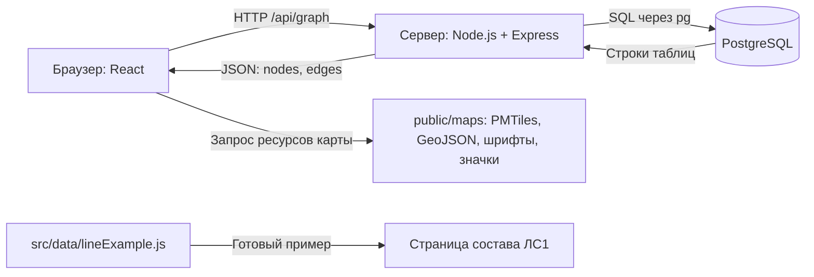
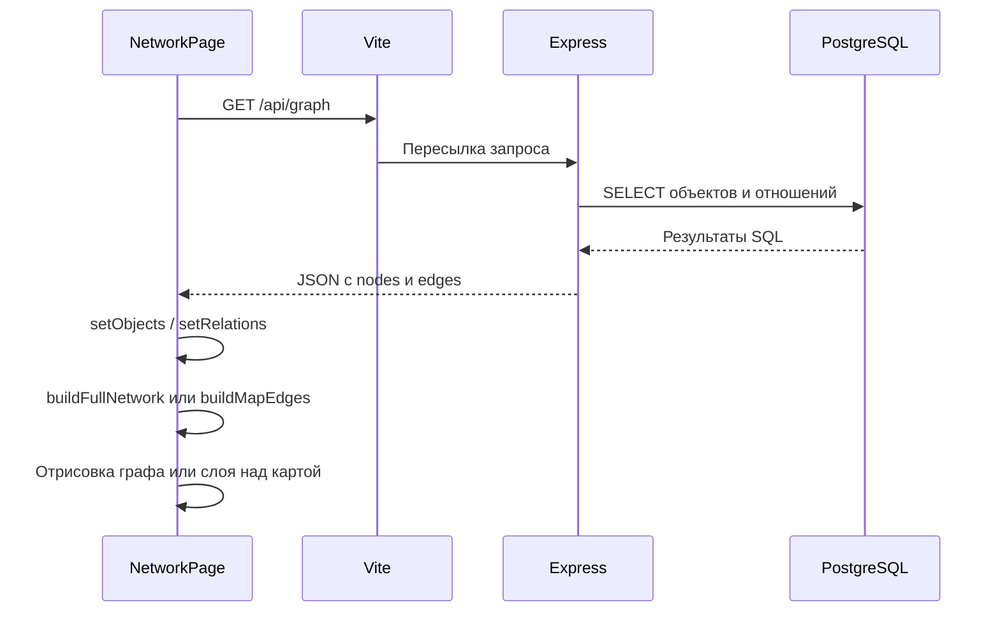

# Устройство проекта сети связи

Руководство по текущей реализации на 21 октября 2026 года. Описывает существующий код, включая демонстрационные данные и ограничения. Начинать чтение рекомендуется с разделов 1–5, затем переходить к нужному сценарию.

## 1. Что делает приложение

Приложение показывает сеть связи и состав её объектов. У него три страницы:

| Адрес | Назначение | Компонент |
| --- | --- | --- |
| `/` | Сеть на карте или полный граф без карты, паспорта объектов и соединений | `src/pages/NetworkPage.jsx` |
| `/objects/:objectId` | Состав выбранного объекта в виде иерархии сверху вниз | `src/pages/ObjectPage.jsx` |
| `/lines/:lineId` | Состав линии: пример ЛС1 либо заглушка для других ID | `src/pages/LinePage.jsx` |

Двоеточие обозначает переменную часть адреса: вместо `:objectId` подставляется идентификатор объекта. Маршруты перечислены в `src/App.jsx`.

## 2. Три основные части



**Интерфейс (frontend)** работает в браузере. React создаёт кнопки, страницы, паспорта и карточки; библиотеки графа и карты рисуют схемы. Интерфейс не выполняет SQL и не получает пароль базы.

**Сервер (backend)** — отдельный процесс Node.js с Express. Он принимает HTTP-запросы, проверяет параметры, обращается к PostgreSQL и возвращает результат в JSON — текстовом формате структурированных данных. Его исходный код находится в `server/index.js`.

**PostgreSQL** хранит объекты, отношения, справочники и координаты. Данные сохраняются в самой базе, а не в файлах React. Папка `database/migrations` содержит инструкции создания структуры базы; это не копия её текущего содержимого.

При разработке одновременно работают Vite и API. Vite обслуживает интерфейс и ресурсы, а запросы с префиксом `/api` пересылает серверу на `127.0.0.1:3001`. Это настроено в `vite.config.js`. Адрес интерфейса нужно смотреть в терминале Vite: в текущем сеансе это порт 5174, но он не закреплён в конфигурации.

## 3. Как начинается выполнение

1. Браузер получает `index.html`, где есть контейнер `<div id="root">` и подключение `src/main.jsx`.
2. `main.jsx` запускает React через `createRoot` и помещает `App` в контейнер.
3. `App.jsx` выбирает страницу по адресу через React Router.
4. Страница загружает данные, хранит состояние и передаёт данные дочерним компонентам.
5. При изменении состояния React обновляет соответствующие части интерфейса.

В `main.jsx` включён `StrictMode`: в режиме разработки React может дополнительно запускать цикл установки и очистки эффектов. Поэтому в Network может быть виден дополнительный отменённый запрос; это само по себе не означает двойную запись в базе.

Переходы через `Link` переключают страницы внутри приложения. Это не отдельные HTML-файлы и не обязательно новая вкладка браузера.

## 4. Что считается объектом и связью

В используемой схеме IMC объекты представлены СФЭ. В рамках приложения это общий тип записи: узел связи, линия связи, оборудование и другие элементы.

| Таблица | Роль в чтении графа |
| --- | --- |
| `imc.thematic_layers_sfes` | Объекты: ID, код `vr_code`, ссылки на слой и шаблон |
| `imc.thematic_layers_sfe_linkings` | Направленные отношения между объектами |
| `imc.thematic_layers` | Названия тематических срезов |
| `imc.sfe_templates` | Шаблоны объектов |
| `imc.sfe_kinds` | Виды объектов |
| `imc.dc_records` | В том числе подписи отношений, используемые API |
| `imc.network_node_locations` | Координаты объектов, добавленные для карты |

**Линия связи сама является объектом.** Например, база может хранить объект ЛС1 и два отношения: `ЛС1 → УС1`, `ЛС1 → УС2`. В режиме полного графа видны три карточки и два ребра. На карте функция `buildMapEdges` превращает их в одну линию `УС1 — УС2`, сохраняя ссылку `lineId` на ЛС1.

Нужно различать три уровня идентификаторов:

- UUID объекта базы — например, ID ЛС1; используется в адресе `/lines/:lineId`.
- ID отношения базы — обозначает конкретную связь двух записей, а не саму ЛС1.
- ID визуального элемента — например, `map-line:<UUID>:0`, созданный для отрисовки; это не ID записи базы.

У примера состава ЛС1 есть ещё свои локальные ID `LS1-001`–`LS1-020` и `LS1-R01`–`LS1-R27`. Они не являются UUID объектов или отношений PostgreSQL.

## 5. Как данные проходят от базы до экрана



`NetworkPage` запускает загрузку в `useEffect`. Помощник `fetchJson` из `src/utils/api.js` выполняет запрос и преобразует ошибки сети, HTTP и некорректного JSON в сообщения.

Сервер выполняет два SQL-запроса: один для объектов с метаданными и координатами, другой для прямых отношений СФЭ → СФЭ через `id_ls_sfe`. Отношения к внешним справочным записям не превращаются этим API в рёбра графа.

Пример формы ответа, где ID намеренно условные:

```json
{
  "nodes": [
    {
      "id": "UUID объекта",
      "lng": 37.62,
      "lat": 55.75,
      "data": {
        "label": "УС1",
        "type": "Вид объекта",
        "templateName": "Узел связи",
        "layerId": "UUID среза",
        "layerName": "Название среза"
      }
    }
  ],
  "edges": [
    { "id": "UUID отношения", "source": "UUID источника", "target": "UUID цели", "label": "имеет" }
  ],
  "unlocatedCount": 0
}
```

У API-рёбер также есть исходные поля оформления; представления интерфейса переопределяют их. `lng` — долгота, `lat` — широта; при отсутствии координат API возвращает `null`. Название берётся из `vr_code`, с запасными вариантами — названием шаблона или ID.

**Данные читаются из базы при каждом запросе API, но экран не обновляется непрерывно.** Основная страница и страница объекта загружают граф при монтировании. Таймера обновления, WebSocket и общей системы подписок сейчас нет. Внешние изменения базы видны после повторной загрузки данных, например после обновления страницы. После сохранения координат интерфейс отдельно обновляет своё состояние.

Два SELECT выполняются параллельно без общей транзакции снимка: при одновременном изменении базы это не гарантированно единый снимок на один момент времени.

## 6. Как строятся разные графы

### Полная сеть без карты

`src/utils/fullNetwork.js` содержит `buildFullNetwork` — преобразование объектов и отношений в узлы и рёбра React Flow с экранными координатами.

- Типы определяются по тексту `templateName` или `type`: «узел связи», «линия связи».
- Линии располагаются вверху, узлы связи ниже, оборудование — в колонках под узлами.
- Для соединений выделяются отдельные горизонтальные дорожки `laneY` и точки подключения карточек.
- Оборудование размещается обходом исходящих отношений. При нескольких владельцах используется первый найденный; остальные допустимые отношения остаются в графе.
- Объекты, не попавшие в основные группы, размещаются отдельно. Отношения с отсутствующими концами отбрасываются.
- `getNetworkSelection` определяет элементы для подсветки выбранной линии и её концов.

`RoutedEdge.jsx` рисует пути SVG по рассчитанным дорожкам. Видимая линия тонкая, но область взаимодействия шире (`interactionWidth={20}`). Раздельные дорожки уменьшают наложения, однако не гарантируют полного отсутствия пересечений.

Экранные `position.x/y` вычисляются заново и не сохраняются в базу. Карточки сейчас нельзя перетаскивать по отдельности; пользователь перемещает и масштабирует всю сцену.

### Сеть на карте

`PhysicalMap.jsx` создаёт карту MapLibre. Внутренний компонент `MapGraphOverlay` в `NetworkPage.jsx` размещает поверх неё HTML-карточки и SVG-линии.

`map.project([lng, lat])` переводит географические координаты в пиксели. При событиях отрисовки карты позиции карточек, линий и паспорта пересчитываются. Поэтому они перемещаются вместе с картой.

На карте отображаются только объекты с числовыми координатами. `buildMapEdges` собирает связи через объекты линий и сохраняет прямые отношения между расположенными объектами. Если у линии больше двух расположенных концов, текущая реализация соединяет первый с каждым из остальных. Реальная трасса кабеля по географии не рассчитывается: показывается прямое соединение.

### Состав узла

`ObjectPage.jsx` получает ID из адреса, запрашивает общий граф и находит выбранный объект. Затем:

1. `buildObjectSubtree` из `utils/objectTree.js` обходит исходящие отношения от корня.
2. Множество `visited` предотвращает повторный обход и зацикливание.
3. `ObjectTree.jsx` использует Dagre для расположения сверху вниз (`rankdir: 'TB'`).
4. React Flow показывает карточки; `DiagramEdge.jsx` размещает подпись возле целевого блока.

Это дерево обхода: при нескольких путях к одному объекту сохраняется первое достижение, а повторные рёбра не включаются. Отбор идёт по направлению всех доступных отношений, а не только по виду «имеет». Поэтому результат не следует считать полной копией произвольного графа или строгой проверкой семантики состава.

Подпись «состоит из» заменяется на «имеет» при построении представления; запись в базе от этого не меняется.

### Состав линии ЛС1

`LinePage.jsx` не обращается к API. Если ID равен `53ff7800-a047-48dd-ba59-50daff0e98d3`, отображается пример из `src/data/lineExample.js`; для остальных ID — заглушка. Эта страница сама не проверяет существование линии в базе.

Пример содержит 20 объектов, 27 отношений и последовательный маршрут из 8 объектов. Это разные списки: маршрут — часть схемы, а не полный состав. Координаты карточек заданы вручную.

Шесть видов отношений: «имеет», «подключён к», «начинается в», «проходит через», «заканчивается в», «входит в». Фильтры меняют отображаемые отношения, а не удаляют объекты. Выбор элемента включает подсветку и описание. Реестр показывает все 20 объектов с ID. Часть трактовок рисунка остаётся помеченной как предположение.

## 7. Паспорт и сохранение координат

Клик по карточке или ребру на главной странице меняет состояние `passport`. Компонент `Passport.jsx` показывает поля и ссылку на состав. Для линии ссылка ведёт на `/lines/:id`, для другого объекта — на `/objects/:id`. У паспорта ребра ссылка на состав линии появляется при наличии `lineId`.

Без карты паспорт привязан к точке сцены: при перемещении используется преобразование `flowToScreenPosition`. На карте привязка пересчитывается через проекцию карты. Положение ограничивается границами экрана.

Сохранение координат проходит так:

1. Форма проверяет числа: долгота от −180 до 180, широта от −90 до 90.
2. `NetworkPage.handleCoordinatesChange` отправляет `PUT /api/nodes/:id/location` с `{ lng, lat }`.
3. Сервер повторно проверяет UUID и диапазоны.
4. SQL создаёт или обновляет запись в `imc.network_node_locations`; неизвестный объект даёт HTTP 404.
5. После успеха страница обновляет координаты в памяти и переводит карту к объекту.

Это существующая операция записи из интерфейса. Полноценного создания, удаления и редактирования объектов/отношений через API сейчас нет. Название endpoint содержит `nodes`, но SQL работает с существующими СФЭ в целом.

## 8. Устройство офлайн-карты

| Ресурс | Назначение |
| --- | --- |
| `public/maps/network-overview.pmtiles` | Общая карта до масштаба 8 |
| `public/maps/network-areas.pmtiles` | Детальная карта с масштаба 9, вокруг сохранённых координат |
| `russia-outline.geojson` | Контур РФ в режиме «Только карта» |
| `military-districts.geojson` | Округа |
| `russia-regions.geojson` | Регионы |
| `fonts/` и `sprites/` | Шрифты подписей и изображения значков |
| `ATTRIBUTION.md` и лицензии | Источники данных и условия использования |

PMTiles — архив картографических плиток. GeoJSON — файл геометрии объектов. Библиотека `pmtiles` позволяет MapLibre получать нужные части локальных архивов по HTTP. `@protomaps/basemaps` задаёт базовые слои оформления.

`mapLayers.js` переключает видимость слоёв и проверяет загруженный GeoJSON. `boundaryOutlines.js` формирует видимые контуры без технических замыкающих линий на меридиане ±180°. Выбранный слой границ загружается по необходимости.

В режиме «Только карта» отображается отдельный контур РФ; в режимах округов и регионов сохраняются также границы стран базовой карты. Геометрии используют территориальное соглашение, описанное в README и `public/maps/ATTRIBUTION.md`; это не данные о текущих линиях контроля.

При обычной работе ресурсы карты берутся с локального сервера приложения. Для подготовки архивов и обновления геометрий скриптам может понадобиться интернет. «Офлайн-карта» не означает, что HTML можно открыть двойным щелчком или что база и API не нужны.

Архивы PMTiles исключены из Git. При переносе на другой компьютер их нужно отдельно скопировать или собрать. Новые координаты не расширяют детальный архив автоматически: его требуется пересобрать.

## 9. Навигатор по файлам

Все пути ниже указаны относительно корня репозитория.

| Файл / каталог | За что отвечает |
| --- | --- |
| `index.html`, `src/main.jsx`, `src/App.jsx` | Вход в приложение и выбор страниц |
| `src/pages/` | Три страницы и управление их состоянием |
| `src/components/Toolbar.jsx` | Переключатели карты и её слоёв |
| `src/components/Passport.jsx` | Паспорт и форма координат |
| `src/components/PhysicalMap.jsx` | Создание карты, стиль, загрузка ресурсов |
| `src/components/NetworkNode.jsx` | Карточка React Flow и точки подключения |
| `src/components/NetworkNodeContent.jsx` | Содержимое карточки, общее для карты и графа |
| `src/components/ObjectTree.jsx` | Отрисовка и автоматическая раскладка состава узла |
| `src/components/RoutedEdge.jsx` | Рёбра полной сети |
| `src/components/DiagramEdge.jsx`, `diagramEdges.js` | Рёбра и общее оформление состава узла |
| `src/utils/` | Запросы API и алгоритмы преобразования данных |
| `src/data/lineExample.js` | Демонстрационный состав ЛС1 |
| `src/App.css`, `src/index.css` | Оформление компонентов и базовые размеры страницы |
| `server/index.js` | HTTP API, SQL, подключение к PostgreSQL |
| `database/migrations/` | SQL создания схемы и таблицы координат |
| `scripts/` | Миграции, импорт, заполнение примера, подготовка карты |
| `*.test.js` | Автоматические проверки алгоритмов и сервера |
| `public/` | Статические ресурсы, доступные по URL от корня сайта |
| `.env` | Локальные настройки подключения, включая секреты; не публикуется |
| `.env.example` | Пример настроек без настоящего пароля |
| `package.json` | Зависимости и команды проекта |
| `package-lock.json` | Зафиксированное дерево зависимостей для установки |
| `vite.config.js`, `eslint.config.js` | Настройка разработки/сборки и проверки кода |
| `node_modules/` | Установленные зависимости; восстанавливаются установкой пакетов |
| `dist/` | Результат сборки; исходный код редактируется не здесь |
| `.gitignore` | Файлы, исключённые из Git |

## 10. Основные понятия React на примере проекта

**Компонент** — функция, описывающая часть интерфейса. Например, `Passport` описывает паспорт, `NetworkPage` — главную страницу. JSX внутри функции выглядит как HTML, но позволяет вставлять JavaScript-выражения.

**Props** — входные параметры компонента. Страница передаёт паспорту `data`, `position` и функцию сохранения `onCoordinatesChange`. Вложенный компонент вызывает эту функцию, а владелец данных выполняет запрос и обновляет состояние.

**State (`useState`)** — память компонента, изменение которой запускает обновление интерфейса. На главной странице это `objects`, `relations`, `passport`, `isMapVisible`, `mapLayer`, состояние загрузки и ошибки. Выбранный паспорт и режим карты не сохраняются в базу.

**Effect (`useEffect`)** — действия вне вычисления JSX: загрузка API, создание карты, подписка на события. Очистка эффекта отменяет запрос через `AbortController` или снимает подписки, когда компонент перестаёт использоваться.

**Memo (`useMemo`)** — сохранение результата вычисления, пока не изменились зависимости: например, пересчёт полной сети при изменении объектов/отношений. Это не постоянное хранилище.

**Ref (`useRef`)** — ссылка на DOM-элемент, экземпляр карты/графа или изменяемое значение без самостоятельного запуска перерисовки React. Нужна, в частности, для быстрого движения элементов над картой.

**Handle** в React Flow — точка подключения ребра к карточке. Это элемент отображения, не отдельный физический порт базы, если модель данных явно не задаёт такой объект.

## 11. API и его границы

| Метод и адрес | Результат |
| --- | --- |
| `GET /` на сервере API | Список endpoint и подсказка о запуске интерфейса |
| `GET /api/health` | Проверка SQL `SELECT 1` и доступности базы |
| `GET /api/graph` | Объекты, прямые отношения и число объектов без координат |
| `GET /api/graph?layerId=<UUID>` | Объекты выбранного среза и отношения, оба конца которых принадлежат ему |
| `PUT /api/nodes/:id/location` | Создание/обновление координат существующего объекта |

Фильтр `layerId` реализован на сервере, но главные страницы сейчас запрашивают граф без него. Параметры SQL передаются отдельно от текста запроса. Ошибки запросов логируются на сервере; клиенту возвращается общее сообщение. Проверка health не подтверждает наличие всех таблиц IMC — она проверяет подключение к базе.

В API нет авторизации, пользовательских прав, постраничной загрузки и событий обновления. Весь граф загружается целиком. Сервер по умолчанию слушает `127.0.0.1` и рассчитан на локальную разработку. Это текущие границы реализации, которые нужно учитывать при размещении для нескольких пользователей.

## 12. Запуск, сборка и обслуживание

Для уже настроенного проекта нужны запущенный PostgreSQL и заполненный `.env`. Имена параметров: `DATABASE_URL`, `API_HOST`, `API_PORT`. Настоящий пароль хранится только в локальной конфигурации.

В двух терминалах из корня проекта:

```powershell
# Терминал 1: API
npm run dev:api
```

```powershell
# Терминал 2: интерфейс
npm run dev
```

`dev:api` следит за изменениями серверного файла; Vite обновляет интерфейс при изменении исходников. Если зависимости ещё не установлены, для установки по lock-файлу используется `npm ci`.

| Команда | Назначение |
| --- | --- |
| `npm test` | Тесты через встроенный `node --test` |
| `npm run lint` | Проверка JavaScript/React через ESLint |
| `npm run build` | Сборка интерфейса в `dist` |
| `npm run preview` | Локальный просмотр собранного интерфейса |
| `npm run start:api` | API без автоматического перезапуска |
| `npm run db:migrate` | Применение миграций для новой базы |
| `npm run db:migrate -- --existing-schema` | Пропуск поставленной базовой схемы и применение дополнений к существующей IMC |
| `npm run db:import -- --seed-dir <папка> --config <файл>` | Импорт исходных XML-данных по конфигурации |
| `npm run db:seed-demo-nodes` | Создание примера УС4–УС9 и соединений в базе |
| `npm run build:military-districts` | Пересборка геометрии округов |
| `npm run build:russia-regions` | Пересборка геометрии регионов |
| `npm run build:russia-outline` | Пересборка контура РФ |

Команды базы изменяют данные или схему; это не обязательные действия при каждом запуске. Импорт и заполнение примера не вызываются страницами приложения. Подробные предварительные условия и команды сборки PMTiles через `scripts/build-offline-map.ps1` приведены в корневом README. Скрипт карты вызывает `create-map-coverage.mjs`; генераторы границ используют общие данные `map-boundaries.mjs`.

Миграции `000`–`002` создают расширение, исходную схему и триггеры IMC; `003` добавляет координаты. Выполненные имена файлов учитываются в `public.network_app_migrations`. Это учёт по имени: изменение уже применённого SQL-файла не запускает его повторно. Для дальнейших изменений схемы следует добавлять новую миграцию.

`npm run build` не запускает API, не переносит базу и не создаёт отсутствующие архивы карты. `preview` тоже не заменяет сервер API; прокси `/api` явно задан в конфигурации dev-сервера. Для размещения необходимо отдельно настроить сервер API, маршрутизацию `/api` и возврат `index.html` для адресов React Router.

## 13. Что и где менять

| Задача | Основные места |
| --- | --- |
| Новая страница / адрес | `src/App.jsx`, `src/pages/` |
| Поле из базы в паспорте | SQL и JSON в `server/index.js`, затем `Passport.jsx` и передача данных на странице |
| Внешний вид карточек сети | `NetworkNodeContent.jsx`, `NetworkNode.jsx`, `App.css` |
| Расположение полной сети | `utils/fullNetwork.js` |
| Маршрут и область нажатия ребра полной сети | `RoutedEdge.jsx` |
| Соединения узлов на карте | `utils/mapGraph.js`, `MapGraphOverlay` в `NetworkPage.jsx` |
| Цвета карты и её границ | `PhysicalMap.jsx` |
| Правила переключения слоёв | `Toolbar.jsx`, `utils/mapLayers.js` |
| Отбор состава узла | `utils/objectTree.js` |
| Раскладка состава сверху вниз | `ObjectTree.jsx` |
| Подписи отношений состава | `DiagramEdge.jsx`, `diagramEdges.js` |
| Объекты, отношения и координаты примера ЛС1 | `data/lineExample.js` |
| Фильтры, реестр и описание ЛС1 | `pages/LinePage.jsx` |
| Новая структура хранения | Новая SQL-миграция, API и соответствующее отображение |

Следует отличать изменение отображения от изменения данных. Перемещение карточки в алгоритме, переименование подписи на экране и скрытие слоя карты не меняют PostgreSQL. Сохранение координат и запуск скриптов базы меняют постоянные данные.

## 14. Как проверять изменения и искать ошибки

Автотесты рядом с исходниками проверяют API через подставной pool, разбор импорта, преобразования графа, выбор линии, состав узла, границы карты, обработку ответов и согласованность примера ЛС1. Они не заменяют полноценную проверку живой базы и интерфейса браузера. После очистки проекта на дату руководства проходят 32 теста и ESLint; сборка успешна с предупреждением о размере JavaScript-пакета.

Для проверки пользовательских сценариев:

1. Открыть главную страницу и проверить загрузку узлов и линий.
2. Переключить карту, округа, регионы и режим без карты.
3. Открыть паспорт узла и линии, переместить и масштабировать сцену.
4. Открыть состав узла; затем пример ЛС1, фильтры и реестр ID.
5. При проверке записи — сохранить заранее выбранные тестовые координаты и после обновления страницы убедиться, что они сохранились.

| Симптом | Где искать причину |
| --- | --- |
| Страница не открывается | Терминал Vite, фактический порт |
| Интерфейс открыт, граф не загружается | Network браузера: `/api/graph`; терминал API; подключение PostgreSQL |
| Health успешен, граф падает | Наличие таблиц/прав IMC и SQL-ошибка в терминале API |
| Объект виден без карты, но отсутствует на карте | Его `lng/lat` и сохранённая запись координат |
| Карта отсутствует или нет детализации | Запросы PMTiles, наличие архивов и покрытие выбранной области |
| Изменение базы не появилось на открытом экране | Повторная загрузка графа: автоматической подписки нет |
| У другой линии пустой состав | Пока реализован только демонстрационный состав ЛС1 |
| В дереве нет повторных связей | Правило первого посещения в `buildObjectSubtree` |

## 15. Порядок дальнейшего изучения кода

1. `index.html` → `main.jsx` → `App.jsx`: понять вход и маршруты.
2. В `NetworkPage.jsx` найти запрос `/api/graph`, `setObjects`, `setRelations`: понять получение состояния.
3. `utils/api.js` → обработчик `/api/graph` в `server/index.js`: проследить HTTP и SQL.
4. `utils/fullNetwork.js` → `NetworkNode.jsx` → `RoutedEdge.jsx`: понять построение схемы.
5. `PhysicalMap.jsx` → `utils/mapGraph.js` → `MapGraphOverlay`: сравнить географическое представление с полной сетью.
6. `Passport.jsx` → `ObjectPage.jsx` → `objectTree.js` → `ObjectTree.jsx`: пройти сценарий состава узла.
7. `LinePage.jsx` → `lineExample.js`: разобрать отдельный демонстрационный сценарий.

Для каждого участка полезно отвечать на четыре вопроса: какие данные он получает, что вычисляет, что отображает и меняет ли что-либо в постоянном хранилище.
